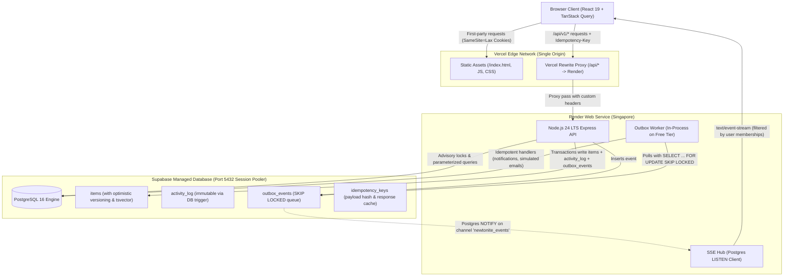

# System Architecture

Newtonite is designed for operational resilience under pressure. The architecture enforces transactional integrity, optimistic concurrency, and zero data leakage using PostgreSQL 16 primitives without external brokers or heavy ORMs.

---

## 1. High-Level Architecture Diagram

---

## 2. Core Subsystems

### 2.1 Web Client (`/web`)
- **Technology:** React 19, Vite, TypeScript strict, TanStack Query, React Router.
- **Styling:** Vanilla CSS variables and CSS modules. Calm, dense, 13px operational design system.
- **Network & Security:**
  - All calls use relative paths (`/api/v1/...`).
  - No API keys or backend hosts exposed in client bundles.
  - Custom header `X-Requested-With: XMLHttpRequest` on all non-GET requests to prevent CSRF.
  - Automatically generates and reuses client-side `Idempotency-Key` headers on mutations.
  - Handles 412 `STALE_VERSION` with an interactive conflict panel showing server differences.
  - Handles 409 `ALREADY_CLAIMED` races without UI crashes.

### 2.2 Server API (`/server`)
- **Technology:** Node.js 24 LTS, Express, Zod validation, `pg` (node-postgres), Pino structured logging.
- **Identity & Auth:**
  - Signed session cookies (`newtonite_session`), `httpOnly`, `SameSite=Lax`, host-only (no `Domain` attribute).
  - Rate limiting keyed by `(IP + email)` to prevent credential stuffing.
- **Authorization (`src/policy.ts`):**
  - Centralized policy engine: `can(user, action, resource)`.
  - Resource scoping enforced **in SQL**: queries join against `team_memberships`.
  - Non-accessible resources return `404 NOT_FOUND` (never `403`) to eliminate metadata probing.
- **Optimistic Concurrency:**
  - Every work item carries an integer `version`.
  - Mutating operations require `If-Match: "<version>"`. Missing -> `428 PRECONDITION_REQUIRED`; mismatch -> `412 STALE_VERSION` returning current server item.

### 2.3 Transactional Outbox Worker (`src/worker.ts`)
- **Queue Engine:** Table `outbox_events` polled using `SELECT ... FOR UPDATE SKIP LOCKED LIMIT 10`.
- **Fault Tolerance:**
  - Worker lease expires after 60 seconds (`lease_expires_at`). Crashed worker jobs are automatically reclaimed by living workers.
  - Exponential backoff: `Math.min(1000 * 2^attempts, 60000)`.
  - Max 5 attempts; exceeding moves record to `dead_letter` status for admin inspection and retry.
- **Idempotency:** Unique composite deduplication keys (`dedupe_key`) prevent duplicate emails or notifications on redelivery.
- **Deployment Mode:**
  - On Render free tier: runs as an in-process background loop inside the Express API process (`RUN_WORKER_IN_API=true`).
  - In Docker Compose / multi-instance production: runs as a standalone Node.js process.

### 2.4 Real-Time SSE Fan-Out (`src/sse.ts`)
- **Connection Architecture:** Uses a dedicated, long-lived `pg.Client` listening on `LISTEN newtonite_events`.
- **Database Trigger:** DB trigger `notify_outbox_event()` fires `pg_notify` immediately upon transaction commit.
- **Security Scoping:**
  - SSE connections are bound to caller memberships at connection time.
  - Events only emit lightweight identifiers (`{ id, team_id, version, type }`).
  - Clients refetch full entity details through authorized REST endpoints.
- **Connection Management:** Heartbeat comment sent every 20 seconds; auto-reconnects with exponential backoff and broadcasts `resync` event on connection recovery. Client falls back to 15-second polling if SSE repeatedly fails.
