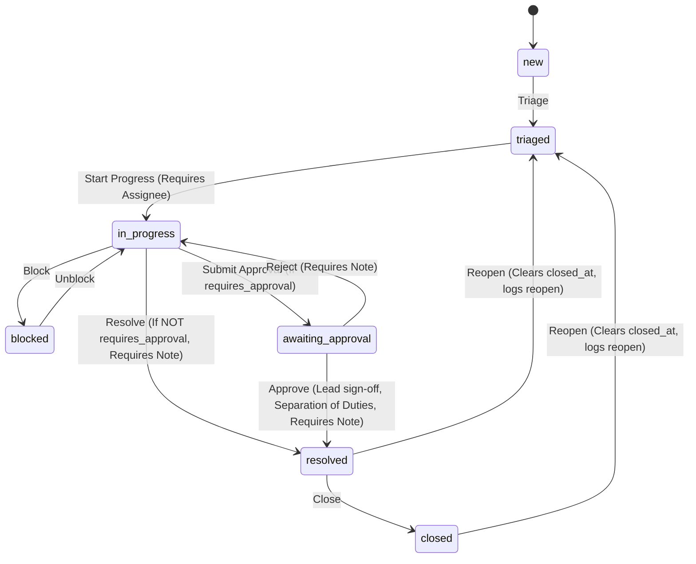

# State Management & Concurrency Architecture

This document describes how state is transitioned, synchronized, and reconciled between the PostgreSQL 16 database, the Express API, and the React client application.

---

## 1. Work Item State Machine (`server/src/transitions.ts`)

Work item statuses strictly follow an explicit server-enforced finite state machine. Transitions outside the defined graph return HTTP 409 `INVALID_TRANSITION`.



### Business Rules Enforced in State Machine
1. **Assignee Requirement:** Transitioning into `in_progress` requires an `assignee_id` on the item.
2. **Resolution Note Requirement:** Transitioning into `resolved` requires a non-empty `resolution_note`.
3. **Approval Status Mapping:** Transitioning to `awaiting_approval` sets `approval_status = 'pending'`. Approving sets `approval_status = 'approved'` and transitions to `resolved`. Rejecting sets `approval_status = 'rejected'` and reverts to `in_progress`.
4. **Separation of Duties:** The user approving an item must have the `lead` role in that team and must not be either the original reporter or the current assignee.
5. **Closed State Immutability:** Closed items accept only comments and reopen transitions.

---

## 2. Optimistic Concurrency Control (OCC)

To prevent silent last-write-wins:
1. Every row in `items` maintains an integer `version` initialized at 1.
2. Every mutation (`PATCH /api/v1/items/:id`) requires an `If-Match: "<version>"` header.
3. The server executes:
   ```sql
   UPDATE items
   SET ..., version = version + 1, updated_at = NOW()
   WHERE id = $1 AND version = $2
   RETURNING *;
   ```
4. **Missing Header:** If `If-Match` is omitted, the API responds with `428 PRECONDITION_REQUIRED`.
5. **Version Mismatch:** If the row in the database has a higher version than the client's `If-Match`, the API returns `412 STALE_VERSION` containing the current server state in `{ error: { details: { current_item } } }`.
6. **Client Conflict Resolution:** The client displays a visual diff panel showing what changed on the server, offering the user the choice to either discard local edits or re-apply local edits on top of the newer version.

---

## 3. Real-Time Synchronization & Cache Invalidation

1. **Server-Sent Events (`/api/v1/events`):**
   - Connected clients receive real-time notifications triggered by PostgreSQL `LISTEN / NOTIFY`.
   - Events carry only metadata (`id`, `team_id`, `version`, `event_type`).
2. **TanStack Query Invalidation:**
   - Upon receiving an event, the client invalidates queries for `['items']`, `['attention']`, and `['item', id]`.
   - The browser automatically refetches the latest entity representation through authorized REST endpoints.
3. **Polling Fallback:**
   - If SSE drops or fails repeatedly (e.g. proxy buffering or sleep), the client seamlessly activates 15-second polling and shows a visible top-bar badge.
